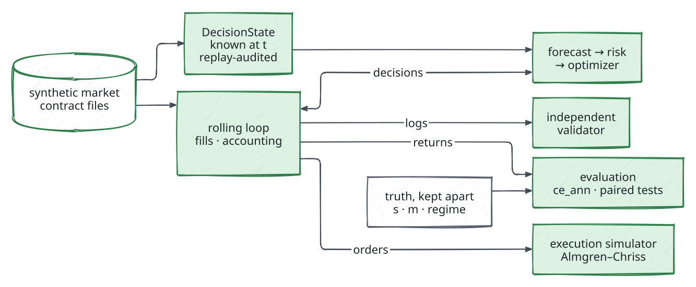
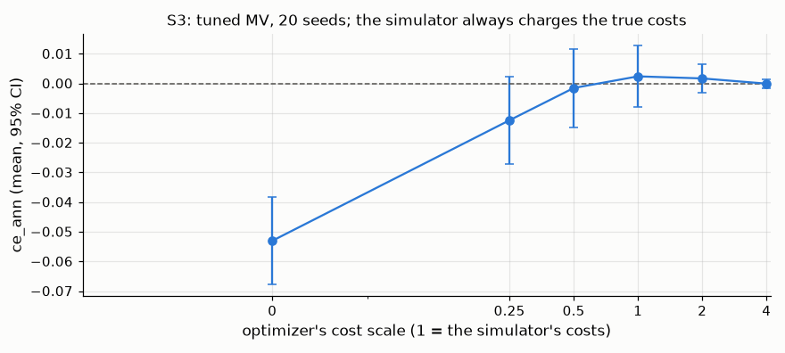
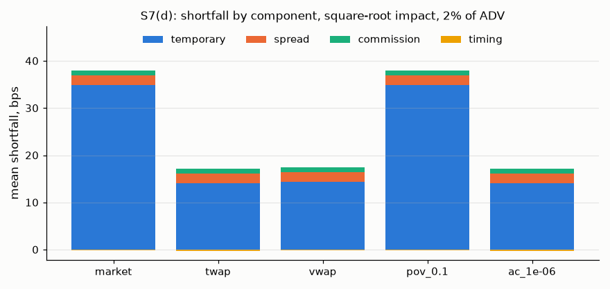

<p align="center"></p>

<p align="center">
<a href="https://github.com/AKASB1/dynamic-trading-engine/actions/workflows/ci.yml"></a>
<a href="LICENSE"></a>


</p>

# Dynamic Portfolio & Execution Engine

A simulation-only decision layer: a rolling predict-then-optimize loop, convex portfolio optimizers, multi-period control, and an execution simulator on a synthetic market.

<p align="center"><a href="#installation">Installation</a> · <a href="#quickstart">Quickstart</a> · <a href="#results">Results</a> · <a href="#key-concepts">Key concepts</a> · <a href="#important-links">Important links</a> · <a href="#limitations">Limitations</a></p>

**Research and simulation software. Not investment advice. No live trading, no broker connectivity.**

> **Synthetic data.** Every result here comes from simulations on a synthetic market with a planted, known signal and assumed parameters ([docs/data.md](docs/data.md)).

Portfolio and execution methods are hard to compare honestly: on real data the truth is unknown, and one backtest rarely separates skill from luck. This project runs them on a synthetic market whose truth is known. Each formulation is checked against an exact answer, and every comparison runs on common random numbers; strategies are ranked by one declared criterion. The loop forecasts, estimates risk, optimizes, fills orders at the next open, and keeps exact accounting. An execution simulator works one parent order through intraday intervals, and an information audit tests that no decision sees the future. Live trading, brokers, and vendor data stay outside: the market and every order are simulated.

<p align="center"></p>

## Important links

- [docs/architecture.md](docs/architecture.md): the modules, the rolling loop, and the accounting.
- [docs/contracts.md](docs/contracts.md): the shared file contract with the research engine.
- [docs/data.md](docs/data.md): the synthetic market and its assumed parameters.
- [docs/optimization.md](docs/optimization.md): the optimizers, the exact references, and the failure rule.
- [docs/execution.md](docs/execution.md): the execution simulator and its policies.
- [docs/information.md](docs/information.md): the knowledge-bounded state, the replay audit, and the canaries.
- [docs/protocol.md](docs/protocol.md): the criterion, the tuning, and the evaluation protocol.
- [simulations/README.md](simulations/README.md): how to reproduce, every finding with its figures, and the detailed limitations.
- [docs/results.md](docs/results.md) and [docs/results_tier2.md](docs/results_tier2.md): every result table of the evaluation and of the later studies (generated).
- [IMPLEMENTATION.md](IMPLEMENTATION.md), [CONTRIBUTING.md](CONTRIBUTING.md), and the sample run in [docs/examples/sample_run/](docs/examples/sample_run/).

## Highlights

Strategies are compared on `ce_ann`, the annualized certainty equivalent of the net per-bar returns ([docs/protocol.md](docs/protocol.md)). It is `ppy * (mean(r) - (gamma_ce / 2) * var(r))` with `gamma_ce = 6` and `ppy = 252`. `CASH` holds nothing and scores exactly 0.

- **The formulations match their exact references.** The closed forms for mean-variance, minimum variance, and quadratic-cost trading agree to 1e-11 or better. Over the whole evaluation, 454,064 solves are `optimal`, 396 are `optimal_inaccurate` (every constraint within 1.2e-7), and none fail; the accounting identity holds to 8.7e-16 relative ([S1](simulations/README.md#results)).
- **At the default costs no strategy lies above holding cash.** By the rule fixed before the evaluation the named strategy is `ROBUST`, the robust mean-variance optimizer (`ce_ann` 0.0045 ± 0.0101). It separates from equal weight and from the naive long/short baseline, but not from `CASH` ([S2](docs/results.md#s2-main-comparison-base-market-30-seeds-tuned-with-16-trials-each-on-seeds-100-103)).
- **Ignoring costs is expensive.** With the tuned mean-variance configuration, the parity setting assumes the simulator's true costs. An optimizer that ignores costs loses 0.0554 ± 0.0131 of `ce_ann` against it, on every one of 20 seeds (0/0/20) ([S3](docs/results.md#s3-constraints-costs-schedule-tuned-mv-at-the-parity-setting-20-seeds)).
- **The controller approaches the Garleanu–Pedersen solution as its horizon grows.** With one asset and quadratic costs, its gap in discounted utility falls to at most 0.094 % at horizon 10 and at most 0.001 % at horizon 20 ([S6](docs/results.md#s6a-controller-vs-the-garleanu-pedersen-closed-form-gap-in--of-the-closed-form-utility)).
- **No execution baseline beats the Almgren–Chriss schedule in its own world.** The Monte Carlo means of every schedule lie within one standard error of the closed form. No baseline has a lower cost-risk objective `E + lambda V` than the Almgren–Chriss schedule for the same risk weight, `ac(lambda)`, at any of the 7 values of `lambda` ([S7](docs/results.md#s7a-execution-frontier-exact-almgren-chriss-world-closed-form-and-monte-carlo)).
- **Every canary is caught by its guard.** Four canaries leak on purpose. Two forecasts peek at the future, through a memoized market handle or by reading the files by path; a covariance is estimated on the whole sample; an oracle is unlabeled. The audit catches each, and no strategy, forecast provider, risk model, or optimizer of the evaluation raises an alarm ([docs/information.md](docs/information.md)).

## Installation

You need Python 3.12; the dependencies are in `pyproject.toml` (NumPy, SciPy, CVXPY with Clarabel, OSQP and SCS for tests, Matplotlib; pytest, pytest-repeat, and ruff for development). Create the environment and activate it. In Windows PowerShell:

```powershell
powershell -ExecutionPolicy Bypass -File scripts\setup_env.ps1
.\.venv\Scripts\Activate.ps1
```

On Linux or macOS (bash):

```bash
bash scripts/setup_env.sh
source .venv/bin/activate
```

`setup_env.sh` takes the interpreter from `PYTHON`, else `python3`, else `python`. Call the shell scripts through `bash`, or run `chmod +x scripts/*.sh` once. Set `PYTHONUTF8=1` on Windows if your shell does not.

## Key concepts

- The market generator draws a factor market with a latent signal of persistence 0.9 and a per-bar information coefficient of 0.02, and publishes a noisy proxy, `signal_x`. The truth (the signal, the conditional mean, the regime, the covariance) is a separate object that only labeled oracles, the evaluators, the audit, and the tests receive ([docs/data.md](docs/data.md)).
- Decisions see the market only through a knowledge-bounded, read-only `DecisionState`. A replay audit reruns every strategy in a copy of the market poisoned after the decision instant, and the orders must be bit-identical ([docs/information.md](docs/information.md)).
- The rolling loop decides every 5 bars after a 260-bar warmup and fills at the next open with the contract's costs. The accounting identity is asserted on every bar, and an independent validator re-derives it from the logs ([docs/architecture.md](docs/architecture.md)).
- All files follow a shared, language-neutral contract with the research engine ([docs/contracts.md](docs/contracts.md)).

## Available models

- Forecast providers: `none`; `plain`, a pooled regression of the next-bar return on `signal_x`; and the labeled bounds `noisy_oracle(rho)` and `oracle`.
- Risk models: sample, exponentially weighted, Ledoit–Wolf, and a principal-component factor model, with an eigenvalue floor.
- Optimizers: equal weight (`EW`), a rank-weighted long/short baseline (`RANK_LS`), minimum variance (`MINVAR`), mean-variance with the contract's convex cost model (`MV`; `MV_NC` is the same optimizer tuned with costs ignored), CVaR (`CVAR`), robust mean-variance with box and ellipsoidal sets (`ROBUST`), and a model-predictive controller (`MPC`). The later studies add a Wasserstein-robust mean-CVaR (`WDRO`) and a multi-asset Garleanu–Pedersen rule (`GP_AIM`). All run on CVXPY with open-source solvers. The `LO` book is long only and fully invested; the `LS` book is dollar neutral ([docs/optimization.md](docs/optimization.md)).
- Exact references R1 to R8: closed forms, optimality conditions, the Garleanu–Pedersen solution, dynamic programs, and the Almgren–Chriss schedule.
- Execution policies: market, TWAP, VWAP, POV, Almgren–Chriss, and an adaptive re-planning schedule ([docs/execution.md](docs/execution.md)).

## Quickstart

Run the tests, the quick experiments, the validator, the audit, one run with its report, and the microbenchmarks. In Windows PowerShell:

```powershell
python -m pytest -q
python -m dynamic_trading_engine experiment --quick --workers 2
python -m dynamic_trading_engine validate --root experiments/outputs/quick/logs
python -m dynamic_trading_engine audit --out experiments/outputs/audit_table.csv
python -m dynamic_trading_engine run --strategy MV --market tiny --seed 1 --out experiments/outputs/demo
python -m dynamic_trading_engine report --run experiments/outputs/demo/run --out experiments/outputs/demo/report
python -m dynamic_trading_engine bench --quick
```

On Linux or macOS (bash):

```bash
python -m pytest -q
python -m dynamic_trading_engine experiment --quick --workers 2
python -m dynamic_trading_engine validate --root experiments/outputs/quick/logs
python -m dynamic_trading_engine audit --out experiments/outputs/audit_table.csv
python -m dynamic_trading_engine run --strategy MV --market tiny --seed 1 --out experiments/outputs/demo
python -m dynamic_trading_engine report --run experiments/outputs/demo/run --out experiments/outputs/demo/report
python -m dynamic_trading_engine bench --quick
```

| Command | What it does |
|---|---|
| `tune`, `freeze`, `experiment` | the full protocol: tuning, frozen configurations, one evaluation ([simulations/README.md](simulations/README.md)) |
| `tier2 tune`, `run`, `adaptive`, `solvers`, `tails`, `costmis`, `capacity`, `export` | the later studies, with their own frozen configurations |
| `quickhash` | the SHA-256 of the quick result files without their `wall_` columns |
| `audit`, `run`, `validate`, `report` | the information audit, one run with the contract's logs, the validator, a report |
| `generate`, `sample`, `bench` | a synthetic market as contract files, the committed sample run, microbenchmarks |

The commands use 2 worker processes and one BLAS thread per process. Outside the `wall_` columns, results are byte-identical for the same configuration and seed on one platform and software stack. One independent check on Linux found the quick results within about 1e-3 relative per run of the committed ones, not byte for byte ([simulations/README.md](simulations/README.md#later-studies)).

## Results

The evaluation uses the `base` market (30 instruments, 1260 daily bars). Every strategy with parameters was tuned once with 16 random-search trials on tuning seeds 100 to 103 and frozen. The evaluation ran once on seeds 1000 and up, on commit `d85f01c`. The main comparison, S2 (30 seeds; `CASH` is a reference, not a registered strategy):

| strategy | ce_ann (95% CI) | vs EW (W/T/L) | Sharpe | gross exp. | flat bars |
|---|---|---|---|---|---|
| CASH | 0.0000 ± 0.0000 | +0.0789 ± 0.0490 (24/0/6) | 0.00 | 0.00 | 1.00 |
| EW | -0.0789 ± 0.0490 | - | 0.33 | 1.00 | 0.00 |
| MINVAR | -0.0486 ± 0.0460 | +0.0303 ± 0.0139 (26/0/4) | 0.36 | 1.00 | 0.00 |
| RANK_LS | -0.1277 ± 0.0278 | -0.0488 ± 0.0578 (9/0/21) | -0.67 | 1.46 | 0.00 |
| MV | 0.0011 ± 0.0110 | +0.0800 ± 0.0526 (23/0/7) | 0.07 | 0.48 | 0.00 |
| MV_NC | 0.0003 ± 0.0005 | +0.0792 ± 0.0491 (24/0/6) | 0.06 | 0.02 | 0.01 |
| CVAR | -0.0001 ± 0.0036 | +0.0788 ± 0.0484 (25/0/5) | -0.00 | 0.23 | 0.11 |
| ROBUST | 0.0045 ± 0.0101 | +0.0834 ± 0.0521 (23/0/7) | 0.10 | 0.35 | 0.17 |
| MPC | -0.0136 ± 0.0202 | +0.0653 ± 0.0554 (23/0/7) | 0.08 | 1.10 | 0.00 |

The tuned long/short optimizers hold small books, and their `ce_ann` intervals contain zero; `EW`, `MINVAR`, and `RANK_LS` lie below cash. The comparison against `RANK_LS` and the deflated Sharpe ratio are in [docs/results.md](docs/results.md).



*S3, the cost frontier's right panel: the simulator always charges the true costs, and only the optimizer's cost scale changes. At parity the optimizer assumes the simulator's costs (scale 1). Against parity, scale 0 loses 0.0554 ± 0.0131 of `ce_ann` and scale 0.25 loses 0.0148 ± 0.0096. From 0.5 to 4 the differences include zero. The turnover and cost-drag panel is in [simulations/README.md](simulations/README.md#results).*



*S7(d), the decomposition at 2 % of ADV (average daily volume). TWAP, VWAP, and `ac(1e-6)` cost 16.9 to 17.2 bps against 37.9 bps for sending everything at once. POV 10 % (trading 10 % of each interval's volume) executes the same as the market order here. Temporary impact is the largest component; permanent impact and opportunity cost are zero in this setting. The cost-risk frontier is in [simulations/README.md](simulations/README.md#results).*

Key assumed parameters ([docs/data.md](docs/data.md)):

| Assumption | Value |
|---|---|
| Market | 30 instruments, 1260 daily bars; one market and three sector factors |
| Signal | persistence 0.9, per-bar information coefficient 0.02 |
| Costs | 2 bp half spread, 1 bp commission, square-root impact |
| Schedule | decisions every 5 bars after a 260-bar warmup, next-open fills |
| Capital | 10 million initial capital |

The information ladder, risk models, distribution shift, multi-period control, execution, re-costing, the sensitivity settings, and the later studies are in [simulations/README.md](simulations/README.md#results).

## Evaluation protocol

- One declared criterion, `ce_ann`, selects configurations, orders tables, and decides highlights.
- Every strategy with parameters gets the same tuning effort: 16 random-search trials on tuning seeds 100 to 103. Its configuration is frozen before the evaluation.
- The evaluation runs once on seeds 1000 and up; the evaluation refuses any configuration that is not frozen and any lower seed.
- Means carry 95 % Student-t intervals across seeds; comparisons are paired differences on the same seeds, with wins, ties, and losses.
- `CASH` is a reference, and oracle forecasts are labeled bounds, never competitors ([docs/protocol.md](docs/protocol.md)).

## Project layout

```text
src/dynamic_trading_engine/
  contracts/     formats of the shared contract, cost model, canonical hashes
  market/        generator, truth (separate), liquidity, contract-file store, export consumer
  state/         knowledge-bounded view and DecisionState
  forecasts/     none, plain; oracle.py (labeled bounds)
  risk/          sample, EWMA, Ledoit-Wolf, PCA
  optimization/  cached DPP problems, the optimizer family, failure rule, Wasserstein problem
  policies/      multi-period references (Garleanu-Pedersen, grid DPs, controllers), GP rule
  execution/     execution simulator, policies, Almgren-Chriss reference, adaptive policy
  engine/        rolling loop, logs, independent validator
  strategies/    pipeline strategy, factory, scripted test strategies
  analytics/     metrics, statistics
  audit/         poisoned worlds, replay, canary loader, audit table
  experiments/   registry, tuner and guards, runner, S1-S8, SENS, later studies, tables, report
  cli/           command-line entry points
tests/           unit, property, reference, determinism, protocol tests; canaries/; golden fixtures
configs/market/  market configurations
experiments/     configs/registry.json, tuned/ (frozen configurations), results/ (committed)
simulations/     how to reproduce, the findings, and the limitations
docs/            architecture, contracts, data, optimization, execution, information, protocol, results, figures, diagram source, icon
scripts/         setup, figures, tables, diagram, icon
```

## Limitations

- Every result comes from one synthetic market family with a planted signal and assumed parameters.
- Daily bars and market orders only; the execution simulator connects to the loop only through costs.
- At the default costs no strategy lies above holding cash in this market.
- Not built: limit orders and a queue model, an out-of-sample choice of the Wasserstein radius.

Further limitations: [simulations/README.md](simulations/README.md#limitations).

## Recognition

- [cvxgrp/cvxportfolio](https://github.com/cvxgrp/cvxportfolio): portfolio optimization and backtesting on market data, built around multi-period convex optimization. This project runs on a synthetic market with a known truth and checks each formulation against exact references.
- [skfolio/skfolio](https://github.com/skfolio/skfolio): portfolio optimization, factor models, and risk management with a scikit-learn compatible API. This project closes the loop of decisions, fills, accounting, and execution under one fixed evaluation protocol.
- [dcajasn/Riskfolio-Lib](https://github.com/dcajasn/Riskfolio-Lib): portfolio optimization with many risk measures on CVXPY. This project puts a few convex optimizers inside a rolling loop with costs, execution, and an audit.
- [AI4Finance-Foundation/FinRL](https://github.com/AI4Finance-Foundation/FinRL): deep reinforcement learning environments and agents for trading. This project uses convex optimization and multi-period control, checked against exact references.

Papers whose formulations are implemented: Markowitz; Ledoit and Wolf (2004); Rockafellar and Uryasev (2000); Garleanu and Pedersen (2013); Almgren and Chriss (2000); Bailey and Lopez de Prado (the deflated Sharpe ratio); Boyd and co-authors (multi-period trading via convex optimization). None of the projects above is a dependency; the formulations follow the papers.

## License

MIT, see [LICENSE](LICENSE).
