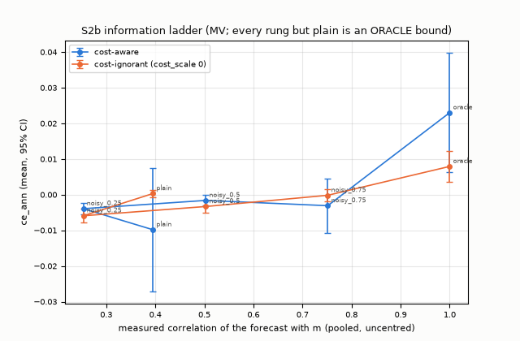
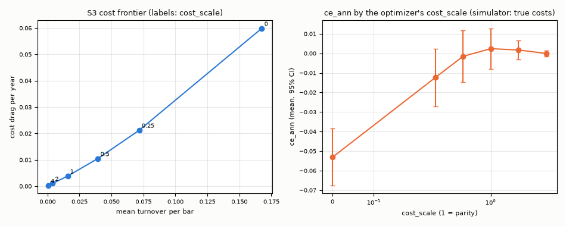
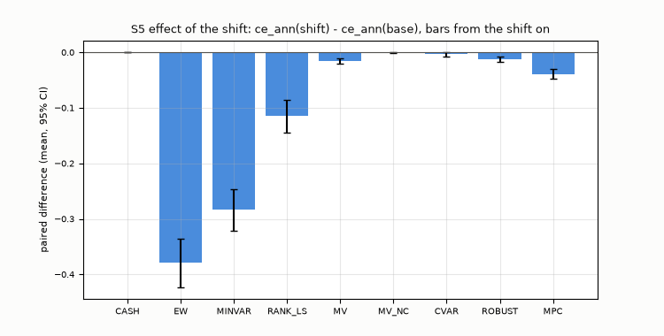
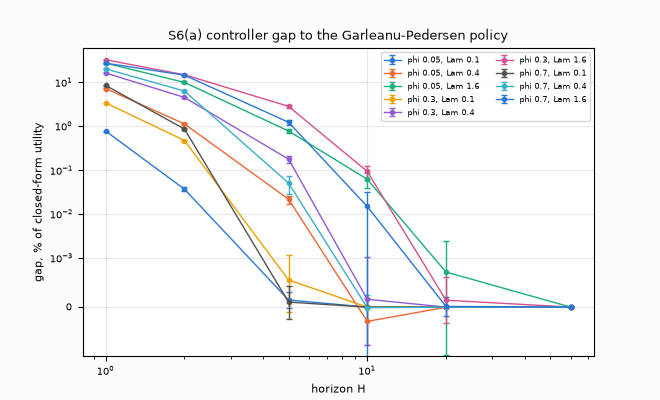
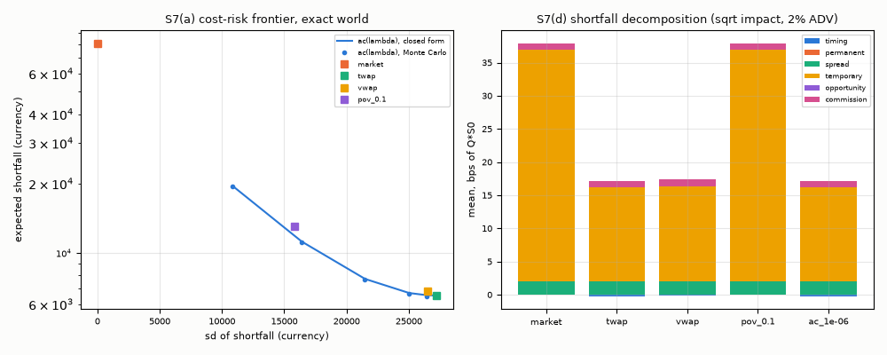

# Simulations

Every number here is simulated on the synthetic market of [docs/data.md](../docs/data.md), with the contract's cost model and the assumptions of [docs/protocol.md](../docs/protocol.md). It shows how the formulations, the controller, and the execution simulator behave.

## How to reproduce

From the repository root, with the environment of the README (`.venv` from `scripts/setup_env.*`) active:

```bash
python -m dynamic_trading_engine tune --workers 2          # protocol tuning run (tuning seeds 100-103) -> experiments/tuned/
python -m dynamic_trading_engine freeze                    # experiments/tuned/frozen.json
python -m dynamic_trading_engine experiment --workers 2    # full evaluation (seeds >= 1000) -> experiments/results/
python -m dynamic_trading_engine audit                     # information audit -> experiments/results/audit_table.csv
python scripts/plot_results.py                             # figures -> docs/figures/
python scripts/make_tables.py                              # tables -> docs/results.md
```

`--quick` versions (the `tiny` market, development seeds 1-3, tuning seeds 100-101, 4 trials, its own frozen file, outputs labeled QUICK under `experiments/outputs/quick/`):

```bash
python -m dynamic_trading_engine tune --quick --workers 2
python -m dynamic_trading_engine freeze --quick
python -m dynamic_trading_engine experiment --quick --workers 2
```

The evaluation refuses a configuration whose hash is not in the frozen file and any seed below 1000; the tuner refuses any seed outside 100-199. Per-run logs (the contract's order, fill, position, and equity files plus `decisions.csv`) are written for the first seed of every variant of S2, S2b, S3, S5 (without its `RETUNED` bound), and S6(c) to the ignored `experiments/outputs/` and checked there by the independent validator; every run asserts the accounting identity in memory.

The later studies (after the evaluation; `experiments/configs/registry_tier2.json`, frozen in `experiments/tuned/frozen_tier2.json`; results in `experiments/results/tier2/`):

```bash
python -m dynamic_trading_engine tier2 tune --workers 2         # WDRO and GP_AIM, 16 trials each on tuning seeds 100-103
python -m dynamic_trading_engine tier2 freeze                   # their tuned configurations -> frozen_tier2.json
python -m dynamic_trading_engine tier2 freeze-more              # the loop configurations of the fat-tail, cost and capacity studies
python -m dynamic_trading_engine tier2 run --workers 2          # WDRO and GP_AIM on base and shift
python -m dynamic_trading_engine tier2 adaptive --workers 2     # adaptive execution (runs in one process)
python -m dynamic_trading_engine tier2 solvers --workers 2      # solver comparison (runs in one process)
python -m dynamic_trading_engine tier2 tails --workers 2        # Student-t and jump markets
python -m dynamic_trading_engine tier2 costmis --workers 2      # cost misspecification
python -m dynamic_trading_engine tier2 capacity --workers 2     # capacity
python -m dynamic_trading_engine tier2 export --workers 2       # export consumer
python scripts/plot_tier2.py                                    # figures -> docs/figures/tier2_*.png
python scripts/make_tables_tier2.py                             # tables -> docs/results_tier2.md
```

The code of the later studies must leave the quick results of the evaluation unchanged: after `python -m dynamic_trading_engine experiment --quick --workers 2`, `python -m dynamic_trading_engine quickhash` prints the SHA-256 of every quick result file without its `wall_` columns, which must equal `experiments/results/quick_sha256.txt` (recorded at the evaluation commit on the build machine: Windows 11, Python 3.12, and the package versions in the manifests). Bit-for-bit equality holds on that platform only: an independent check on Linux with the same versions got quick results that agree to about 1e-3 relative per run but not byte for byte, so compare numerically there. The committed full results were produced on Windows only.

## Results

All numbers below come from the synthetic `base` market (30 instruments, 1260 daily bars; `docs/data.md`), the contract's cost model with its defaults (2 bp half spread, 1 bp commission, square-root impact), decisions every 5 bars after a 260-bar warmup, next-open fills, 10 million initial capital. Every strategy with parameters was tuned once with 16 random-search trials on tuning seeds 100-103 and frozen (`experiments/tuned/`); the evaluation ran once on seeds 1000 and up at commit `d85f01c` (clean tree; 2750 loop runs plus the non-loop experiments in 36 minutes with 2 workers on an x86-64 desktop CPU with 32 logical CPUs, Windows 11, Python 3.12, CVXPY with Clarabel; the versions are in the manifest). Intervals are 95 percent Student-t intervals across seeds; paired differences are on the same seeds (wins/ties/losses). The declared criterion is `ce_ann` (`docs/protocol.md`). Every table: [docs/results.md](../docs/results.md), generated by `scripts/make_tables.py` from `experiments/results/`.

**S2: main comparison** (30 seeds; `CASH` holds nothing and is a reference, not a registered strategy):

| strategy | ce_ann (95% CI) | vs EW (W/T/L) | vs RANK_LS (W/T/L) | Sharpe | gross exp. | flat bars |
|---|---|---|---|---|---|---|
| CASH | 0.0000 ± 0.0000 | +0.0789 ± 0.0490 (24/0/6) | +0.1277 ± 0.0278 (28/0/2) | 0.00 | 0.00 | 1.00 |
| EW | -0.0789 ± 0.0490 | - | +0.0488 ± 0.0578 (21/0/9) | 0.33 | 1.00 | 0.00 |
| MINVAR | -0.0486 ± 0.0460 | +0.0303 ± 0.0139 (26/0/4) | +0.0791 ± 0.0550 (22/0/8) | 0.36 | 1.00 | 0.00 |
| RANK_LS | -0.1277 ± 0.0278 | -0.0488 ± 0.0578 (9/0/21) | - | -0.67 | 1.46 | 0.00 |
| MV | 0.0011 ± 0.0110 | +0.0800 ± 0.0526 (23/0/7) | +0.1288 ± 0.0228 (29/0/1) | 0.07 | 0.48 | 0.00 |
| MV_NC | 0.0003 ± 0.0005 | +0.0792 ± 0.0491 (24/0/6) | +0.1280 ± 0.0274 (28/0/2) | 0.06 | 0.02 | 0.01 |
| CVAR | -0.0001 ± 0.0036 | +0.0788 ± 0.0484 (25/0/5) | +0.1276 ± 0.0271 (28/0/2) | -0.00 | 0.23 | 0.11 |
| ROBUST | 0.0045 ± 0.0101 | +0.0834 ± 0.0521 (23/0/7) | +0.1321 ± 0.0237 (29/0/1) | 0.10 | 0.35 | 0.17 |
| MPC | -0.0136 ± 0.0202 | +0.0653 ± 0.0554 (23/0/7) | +0.1141 ± 0.0207 (30/0/0) | 0.08 | 1.10 | 0.00 |

- By the rule fixed before the evaluation, the strategy named is `ROBUST` (highest mean `ce_ann`, 0.0045 ± 0.0101). It separated from `EW` (+0.0834 ± 0.0521) and from `RANK_LS` (+0.1321 ± 0.0237), **but not from `CASH`: at the default costs no strategy lies above holding cash.** The `ce_ann` intervals of the tuned long/short optimizers (`MV`, `MV_NC`, `CVAR`, `ROBUST`, `MPC`) contain zero, and `EW`, `MINVAR`, and `RANK_LS` lie below cash (`experiments/results/s2_paired.csv`). The tuned long/short optimizers hold small books (mean gross exposure 0.02 to 1.10; `MV_NC` was tuned to a nearly flat book; `ROBUST` and `CVAR` hold nothing on 17 and 11 percent of the bars). Presumably the planted signal (per-bar information coefficient 0.02, observed through a noisy proxy) is too weak against the costs; no run isolates that (the exact oracle of S2b does lie above zero, and so does `MV_NC` at half the simulator's costs, below).
- The deflated Sharpe ratio (the eight registered strategies as the trials of each seed) exceeds 0.95 on 1 of 30 seeds; it assumes selection by the Sharpe ratio while the criterion is `ce_ann`.
- `EW` and `MINVAR` (long only, fully invested) carry the market risk (annualized volatility 0.22 and 0.20) and lose on the variance penalty of `ce_ann` with `gamma_ce = 6`; with `gamma_ce = 3` their mean `ce_ann` is -0.0033 and +0.0113 (SENS, `docs/results.md`).
- SENS against cash (the frozen configurations; the cost settings change the simulator's costs while the optimizer's cost model stays, so they are a misspecification): at half the costs `MV_NC` lies above cash (0.0006 ± 0.0006) and the other long/short optimizers' intervals contain zero; at double the costs `MV` (-0.0131 ± 0.0100) and `MPC` (-0.0483 ± 0.0192) lie below it; on the `stress` market `CVAR` lies below it (-0.0069 ± 0.0066); with `gamma_ce` 12 `MPC` lies below it and with `gamma_ce` 3 none lies above it. `EW`, `MINVAR`, and `RANK_LS` lie below cash in every SENS setting except `gamma_ce = 3`, where the intervals of `EW` and `MINVAR` contain zero (`experiments/results/sens.csv`).

**S2b: information ladder** (MV with forecasts of known quality; every rung but `plain` is an `ORACLE` bound with its own budget of 8 `gamma` values): only the exact oracle has a `ce_ann` interval above zero (0.0230 ± 0.0168 cost-aware, 0.0079 ± 0.0043 cost-ignorant). The plain predictor's measured correlation with the true conditional mean is 0.395, between the noisy oracles with 0.25 and 0.5; neither it nor any noisy oracle has an interval above zero, and the noisy oracles with 0.25 and 0.5 are below zero (cost-aware -0.0039 ± 0.0015 and -0.0016 ± 0.0015). The noisy oracles draw new noise every bar, so their forecasts turn over every bar; their tuned `gamma` sits at the conservative end of the grid except at 0.75 (cost-aware).



**S3: costs, constraints, schedule** (tuned MV at the parity setting `cost_scale` 1, 20 seeds, paired against parity): ignoring costs (`cost_scale` 0) loses 0.0554 ± 0.0131 of `ce_ann` (0/0/20) with 0.17 turnover per bar and a cost drag of 6 percent a year; `cost_scale` 0.25 loses 0.0148 ± 0.0096; from 0.5 to 4 the differences include zero. The long-only book loses 0.0632 ± 0.0526. Turnover bounds, rebalancing every bar or every 21 bars, sector neutrality, and a beta band did not separate from the parity setting (every interval contains zero). The tuned MV itself (tuned `cost_scale` 0.36) is 0.0085 ± 0.0081 below the parity setting on the evaluation seeds.



**S4: risk models** (minimum-variance portfolio, 20 seeds): the realized out-of-sample volatility (the declared quantity) differs by at most 0.002 between the models at the default window (0.200 to 0.202 on `base`); it rises as the window shrinks toward the number of instruments (0.214 to 0.218 at `n/W = 1`). Ledoit-Wolf has the lowest relative Frobenius error at every window and market (0.59 to 0.64) and is below the sample covariance's error at 66 to 74 percent of the decisions; on `wide` (100 instruments) the 3-factor PCA model has the lowest mean realized volatility at every window (0.181 to 0.186), ahead of Ledoit-Wolf by at most 0.0011, far inside the intervals of about ±0.009 (S4 declares no paired test, so this is not a separation).

**S5: distribution shift** (volatility x1.5, correlation x1.5, information coefficient x0.5, premium -5 percent a year from bar 630; 30 seeds; effect = paired `ce_ann` of the bars after the shift, shift run minus base run): the mean effect is negative for every invested strategy: -0.379 ± 0.044 for `EW`, -0.0153 ± 0.0045 for `MV`, -0.0122 ± 0.0048 for `ROBUST`, -0.0034 ± 0.0038 for `CVAR` (interval contains zero), and -0.0389 ± 0.0093 for `MPC`. After the shift, `CVAR` (+0.0102 ± 0.0108) and `ROBUST` (+0.0055 ± 0.0061) are not separated from `MV`; both hold smaller books than `MV`. The `RETUNED` bound (strategies re-tuned on shifted tuning markets) re-selected the same configuration for MV, MV_NC, CVAR, and RANK_LS (exact ties) and configurations with `ce_ann` near zero for ROBUST and MPC.



**S6: multi-period control against the exact references.** (a) Against the Garleanu-Pedersen closed form (one asset, quadratic costs, 20 seeds x 200 paths x 500 steps): the controller's gap in discounted utility falls with the horizon, from 0.8 to 32 percent at `H = 1` to at most 0.094 percent at `H = 10` and at most 0.001 percent at `H = 20`, across `phi_gp` 0.05/0.3/0.7 and `Lam` 0.1/0.4/1.6. (b) Against the proportional-cost dynamic program (one seed, 50 paths, 250 steps): the gaps are within 0.035 percent at `c_prop` 1e-4 and 4e-4 for `H` 1, 5, 20; four of the six are slightly negative (-0.0075 to -0.0049 percent: the controller scored above the program's band policy on these paths, presumably because that band is computed on a grid; not tested). (c) In the market, the controller with the tuned MV configuration gains over `H = 1` (which is MV, bit for bit): +0.0047 ± 0.0040 at `H = 2`, +0.0064 ± 0.0060 at `H = 5`, +0.0067 ± 0.0064 at `H = 10` (15/0/5 each).



**S7: execution** (13 intraday intervals over one bar, 20 seeds x 2000 paths): (a) in the exact Almgren-Chriss world the Monte Carlo means of every schedule are within one standard error of the closed form, and no baseline (market, TWAP, VWAP, POV 10 percent) has a lower `E + lambda V` than `ac(lambda)` at any of the 7 values of `lambda`, in closed form or within the Monte Carlo error; (b) under square-root impact with a U-shaped volume profile, volume noise, and a 10 percent participation cap, TWAP, VWAP, and `ac(1e-6)` cost 9.8 to 10.0 bps of the notional at 0.5 percent of ADV and 16.9 to 17.2 bps at 2 percent, against 28.5 and 37.9 bps for sending everything at once (POV 10 percent executes the same here); at 10 percent of ADV the cap binds and completion falls to 0.93 to 0.97; (c) a latency of 1 or 2 intervals lowers the completion of the slicing policies to 0.80 to 0.93 because they do not plan for it; (d) temporary impact is the largest component (14 to 35 bps of totals of 17 to 38 bps).



**S8: re-costing the loop's orders** (tuned MV at 1e6, 1e7, 1e8 of capital, 10 seeds): executing each parent order with TWAP over its fill bar reproduces the loop's single-print cost (4.6, 6.6, 9.0 bps): the square-root model depends only on the participation rate, which TWAP keeps; executing it all in the first interval costs 8.7 to 20.8 bps. The participation cap binds on 0.34 percent of the loop's orders at 1e8.

**S1: exact references:** the closed forms R1-R3 to 1e-11 or better, R4 below 1e-15 (no solve), R5 9e-7 in the weights, the R6 known answer to 2e-16 and the `H = 60` controller to 4e-15, the grid programs within 0.56 (R6) and 0.26 (R7) grid steps, the R8 known answers to 6e-15 ([figure](../docs/figures/exact_references.png)). Over the whole evaluation: 454,064 `optimal` solves, 396 `optimal_inaccurate` (every constraint within 1.2e-7), 0 failures; the accounting identity held to 8.7e-16 relative.

### Later studies

Each strategy of the later studies was tuned once with the protocol of S2 (16 trials, tuning seeds 100-103) and frozen in `experiments/tuned/frozen_tier2.json` together with every loop configuration of these studies, before they ran (their code: `91b2060` to `cc4e22a`). After every later change the quick results of S1-S8 and SENS reproduced, outside the `wall_` columns, the SHA-256 recorded at the evaluation commit (`experiments/results/quick_sha256.txt`). This bit-for-bit reproduction was checked on the build machine only (Windows 11, Python 3.12, and the package versions in the manifests). An independent check on Linux (x86-64, the same Python and package versions) got quick results that agree with these to about 1e-3 relative per run but not byte for byte: all 20 hashes differed, 172 of the 276 quick runs differ by more than 1e-6 relative in at least one column (at most 1.2e-3 in `ce_ann` and 3.4e-3 in the gross Sharpe ratio, each in a single run), and the S2 quick seed means agree to four digits with the same order of the strategies and the same win/tie/loss counts. That is the usual difference in an interior-point solver's path between math libraries, so on another platform compare the quick results numerically, not by hash. The committed full results were produced on Windows only and were not regenerated on Linux. The committed results of the later studies come from one run on the clean commit `cc4e22a` (2 workers; 1 for the adaptive-execution and solver studies). Tables: `docs/results_tier2.md`.

- **Wasserstein-robust mean-CVaR** (`WDRO`, 30 seeds; `docs/optimization.md`): on `base` its `ce_ann` is -0.0229 ± 0.0199, below `CASH` and below `MV` by 0.0241 ± 0.0126 (7/0/23). On `shift`, the effect of the shift on it is -0.0516 ± 0.0142 (against -0.0153 ± 0.0045 for `MV` in S5; the two effects are not paired with each other), and after the shift it lies below `MV` by 0.0612 ± 0.0221 (5/0/25). Its tuned configuration (radius `eps_w` 2.9e-4, `eta_cvar` 0.0090, `alpha` 0.975, `cost_scale` 0.35) scored best on the tuning seeds (mean `ce_ann` +0.0082) and did not carry over to the evaluation seeds; which parameter is responsible is not isolated.
- **Multi-asset Garleanu-Pedersen rule** (`GP_AIM`, 30 seeds): `ce_ann` 0.0015 ± 0.0089; not separated from `MV` (+0.0004 ± 0.0039, 14/0/16) or from `CASH`, and above `MPC` (+0.0151 ± 0.0127, 17/0/13).
- **Adaptive execution** (5 percent of ADV, square-root impact, cap 0.1; 20 seeds x 2000 paths, common random numbers): with a persistent per-path volume level that the expected profile does not know (log-sd 0.5), re-planning the Almgren-Chriss schedule with the realized volumes lowers the shortfall by 0.238 ± 0.038 bps against the static schedule (by 0.046 ± 0.012 bps when the expected profile is also flat while the true one is U-shaped); with a correct profile it is not separated from the static schedule (-0.0002 ± 0.0037 bps), and with a flat expected and a U-shaped true profile and no level it costs 0.006 ± 0.005 bps more. In this model the temporary impact is computed from the decision-time ADV, not from the interval's realized volume (`docs/execution.md`), so following the volume profile does not lower impact: TWAP costs 0.47 ± 0.06 bps less than VWAP when the profile is right (`docs/results_tier2.md`).
- **Solver comparison** (`docs/figures/tier2_solvers.png`): against the closed forms R1-R3, Clarabel, OSQP, SCS, and HiGHS agree to 6e-7 or better; by the optimizers' failure rule (a status other than optimal or optimal_inaccurate, or a constraint violated by more than 1e-6; the table does not record which), HiGHS failed 1 of 10 quadratic long/short problems at `n` = 30 and OSQP (tolerance 1e-9) failed 17 of the 20 CVaR linear programs; only Clarabel and SCS take the 1.5-power cost (SCS about 10 times slower). Gurobi was not importable in the project environment and was skipped.
- **Fat tails and jumps** (assumed tail models, frozen S2 configurations, 30 seeds): with Student-t (5 degrees of freedom) or jump returns the picture of S5 is unchanged: `CVAR` and `ROBUST` are not separated from `MV` before or after the shift.
- **Cost misspecification** (tuned MV, impact `y` 0.25/0.5/1, capital 1e7/1e8, the optimizer believing half or twice the true costs; 20 seeds): every loss against the parity setting is within 0.006 of `ce_ann`; the only one whose interval excludes zero is believing half the costs at `y` 0.25 and 1e7 (-0.0058 ± 0.0053).
- **Capacity** (tuned MV and the naive RANK_LS from 1e6 to 1e9; `docs/figures/tier2_capacity.png`): MV's mean `ce_ann` stays between -0.006 and -0.001 at every capital with the cap binding on at most 1 percent of its fills; RANK_LS stays far below it (the cap binds on 80 percent of its fills at 1e9, which also limits its trading), so the capacity at which MV falls to the naive baseline is not reached within this grid.
- **Export consumer**: an export written by this repository, read back through the consumer (hashes, schemas, knowledge rule), reproduces the in-memory run's logs exactly; no export of the research engine was available, so that part was skipped.

The experiment list and every grid are in `experiments/configs/registry.json`; the later studies are in `experiments/configs/registry_tier2.json` and [docs/results_tier2.md](../docs/results_tier2.md) (generated).

## Limitations

- Every result comes from one synthetic market family (`configs/market/` holds variants of one generator) with one set of assumed parameters. The ranking on another family is not measured.
- At the default costs no strategy lies above holding cash on this market. Presumably the planted signal is too weak against the costs; no run isolates that.
- `WDRO`'s tuned radius (2.9e-4) did not carry over from the tuning to the evaluation seeds. A nested or walk-forward choice of `eps_w` is not built.
- The audit table covers the strategies, forecast providers, risk models, and optimizers of the evaluation. `WDRO`, `GP_AIM`, and the export forecast provider were added later and are not in it.
- The export consumer is tested on exports written by this repository only; no export of the research engine was consumed.
- The solver comparison skipped Gurobi, which was not importable in the project environment; it is optional.
- The loop and the execution simulator use market orders only; there are no limit orders and no queue model.
- The loop trades daily bars. The execution simulator is tied to it only by the cost parity and the re-costing of S8.
- The test suite and the README commands ran on Windows and once on Linux in an independent check, where two tests failed on platform-dependent last digits; both were fixed, and the GitHub workflow passed on `main` on 2026-10-03. macOS has not been run, and the committed full results were produced on Windows only. On Linux the quick results agree to about 1e-3 relative per run, and no pass tolerance is defined for that comparison.
- Wall-clock numbers (the `wall_` columns and `bench`) come from one desktop machine. The manifests record the hardware class, the worker count, and the thread settings, not the load; the full-scale `bench` output is not committed.
- `pytest` prints OSQP deprecation warnings, because a test passes the renamed OSQP setting `polish`.
